# [GNSS Interference Identification] A Scheme for Frequent-Occurrence GNSS Interference Signal Identification Based on Meta-Learning [with MATLAB + Python Codes]

With the widespread adoption of Global Navigation Satellite Systems (GNSS), the wireless electromagnetic environment around GNSS receivers has become increasingly complex. Satellite navigation signals may be subject to intentional or unintentional interference, leading to reduced accuracy in GNSS positioning. Therefore, identifying the type of interference is essential. Identifying the type of interference helps to quickly implement specific anti-interference measures, thereby enhancing the performance of satellite navigation systems. Currently, research on GNSS interference identification primarily relies on data-driven methods. However, in real-world scenarios, intelligent recognition of GNSS interference signals faces challenges, including low-quality datasets and scarcity of labeled samples, resulting in fewer issues.The mainstream method for solving small sample problems involves extending and enhancing the number of samples or features at the data level rather than focusing on the model algorithm level. In response to the aforementioned issue, this paper proposes a few-shot GNSS interference signal identification scheme based on meta-learning. In this scheme, we utilize Meta-Learning (MAML) that is unrelated to the model as an algorithm to optimize model parameters and improve the traditional training process. Replacing the traditional training process with MAML means developing a model with strong generalization capabilities capable of quickly adapting to new tasks with minimal interference signal samples.This paper combines MAML with the enhanced ResNet architecture, which incorporates a squeeze-and-excitation (SE) channel attention mechanism. The MAML+SE-ResNet model is introduced. SE-ResNet is used for feature extraction and recognition monitoring of GNSS interference signals in scenarios with few samples. On the other hand, MAML randomly extracts multiple sample data from the dataset to form a task, allowing network training at the task level.Experimental results show that, compared with the state-of-the-art traditional machine learning models, the proposed MAML+SE-ResNet model significantly improves the recognition accuracy of small sample GNSS interference signals under different interference noise ratios (JNR). The results indicate that the MAML+SE-ResNet outperforms pre-trained models in terms of generalization performance across various JNRs. The GNSS interference signal identification scheme based on meta-learning for small sample conditions proposed in this paper holds significant practical significance and application value.
Introduction
The Global Navigation Satellite System (GNSS) has become an indispensable auxiliary facility in our lives due to its high-precision positioning, wide coverage, and the ability to provide real-time information on specific locations and speeds anywhere in the world. Over the past few decades, GNSS has played a significant role in both military and civilian sectors, widely applied across various fields of social life, driving major technological transformations in industries such as precision guidance, ship navigation, vehicle monitoring, logistics scheduling, and geological disaster management (Broumandan et al., 2017).
However, in practical applications, with the expansion of GNSS usage, the wireless environment where GNSS receivers operate is becoming increasingly complex, and interference phenomena are becoming more frequent. These factors often lead to various intentional or unintentional interferences in the GNSS operational environment. The presence of these interferences can drown out valid information, posing a significant threat to the reliability and accuracy of the navigation satellite system (Ge, 2022). In light of these circumstances, research on GNSS interference detection and identification has emerged in recent years, leading to the proposal of various interference identification methods by numerous scholars.
As the most widely used. One of the most common navigation methods. How to accurately and efficiently identify the types of interference encountered by GNSS. And minimize the adverse effects caused by such interference. It is a key requirement for realizing high-precision satellite navigation signals. Chang et al. (Kang et al., (2014) proposed a time-domain signal tracking algorithm. Used to estimate the frequency of linear frequency modulation (LFM) GNSS interference. To achieve interference identification. And the algorithm is further improved by adaptive fading Kalman filter and low pass Differential (LPD).Swinney et al. (2021) employed a variety of machine learning classifiers to classify GNSS interference signals, including Support Vector Machines (SVM), Logistic Regression (LR), and Random Forests (RF). References (Ge, 2022; Guo, 2022; Mehr and Dovis, 2022; Morales Ferre et al., 2019) utilized deep neural networks based on data-driven methods, leveraging Convolutional Neural Networks (CNNs) to extract and identify features from the two-dimensional time-frequency plots of GNSS interference sources.Yang et al. (2022) focused on one-dimensional sequence features of interference signals and utilized two machine learning networks - a one-dimensional convolutional neural network (1D-CNN) and a bidirectional long short-term memory neural network (BiLSTM-NN) - to learn and test GNSS interference signals. Fu et al. (2022) proposed a time-frequency analysis Long Short-Term Memory (TF-LSTM) neural network method for GNSS interference signal identification, integrating the Long Short-Term Memory (LSTM) neural network into the identification algorithm, and combining time-frequency (TF) analysis for signal preprocessing.
Despite ongoing advancements in research on GNSS interference signal identification, most studies are premised on the availability of sufficient data. However, in real-world scenarios, GNSS interference signal identification often faces challenges such as low-quality datasets and limited labeled sample data, leading to small sample scenarios. Recently, scholars have begun to focus on the problem of GNSS interference signal identification under small sample conditions. Luo et al. (Luo et al., 2023) proposed a time-frequency self-attention model that extracts global deep features of interference signals by learning the correlation between any two points in the time-frequency spectrum of the interference signals, thereby improving the accuracy of interference recognition under small sample conditions.Felix and his team (Ott et al., 2024) introduced a method for small-sample learning (FSL) to adapt to new GNSS interference categories. They adopted a quadruplet selection strategy, enabling the model to learn representations from both positive and negative interference categories.
The mainstream methods for dealing with small sample problems currently focus on increasing and enhancing the number of samples or features from the data layer, rather than optimizing model algorithms. Additionally, issues such as insufficient recognition accuracy and limited generalization capabilities in models remain unresolved (Miao, 2023). To address these problems, this paper proposes a meta-learning-based framework for GNSS interference signal identification to handle small sample conditions. We employ an unrelated meta-learning (MAML) method to optimize the model, thereby developing a model with high generalization capability that can quickly adapt to new tasks using only a few interference signal samples.This paper introduces the MAML+SE-ResNet model architecture, which combines meta-learning with convolutional neural networks (CNN) and enhances it through residual modules and channel attention mechanisms. It utilizes SE-ResNet to extract features from GNSS interference signals converted into time-frequency diagrams via Short Time Fourier Transform (STFT), thereby constructing the interference identification problem as an image classification task. The experimental dataset is generated using a virtual software simulation, covering six common types of GNSS interference signals. Compared with advanced pre-trained machine learning models, experimental results show that under various signal-to-noise ratio (JNR) conditions, the performance of MAML+SE-ResNet is superior to the pre-trained models.Empirical experiments have shown that, under different JNR conditions, the proposed MAML+SE-ResNet model has significantly superior generalization ability and recognition accuracy compared to advanced traditional machine learning models. The model achieves a recognition accuracy of 95% or higher at high JNR conditions, and even in low SNR conditions of -14 dB, the recognition accuracy can reach 60%.
The rest of the paper is organized as follows: Section 2 conducts a mechanism analysis and mathematical modeling for six common GNSS interference signals. Section 3 introduces the processing of interference signals, using Short-Time Fourier Transform (STFT) to obtain the two-dimensional time-frequency plot of the interference signal, thereby reconstructing the interference identification problem as an image classification problem. Section 4 elaborates on the MAML algorithm used and the construction of the MAML+SE-ResNet model. Section 5 introduces the establishment of the small sample GNSS interference signal dataset and corresponding experimental settings. Section 6 compares and analyzes the experimental results, comparing the results of our proposed model with those of other advanced models. Finally, Section 7 summarizes the research findings.
Illustrations are included in the article.
Conclusion
This paper proposes a global navigation satellite system (GNSS) interference signal identification scheme suitable for small sample scenarios. The scheme utilizes the model-agnostic meta-learning (MAML) strategy and integrates the SE-ResNet network architecture with channel attention mechanism, effectively identifying GNSS interference signals under small sample conditions. Compared to traditional machine learning methods, this scheme optimizes the training process through MAML, allowing the model to quickly adapt to new tasks with only a small amount of sample data, demonstrating strong generalization capabilities.Experimental results show that the MAML + SE - ResNet model outperforms pre-trained models in terms of recognition accuracy and generalization performance under different JNR conditions, thus verifying the effectiveness and superiority of the proposed method in small sample scenarios. This study provides a new solution for GNSS interference signal identification and lays the foundation for further development in this field.
End

## Images

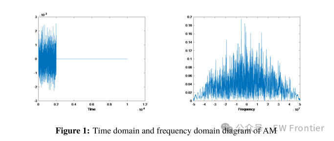
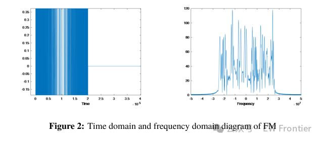
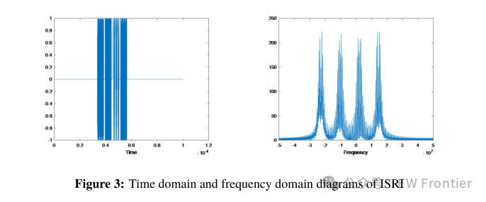
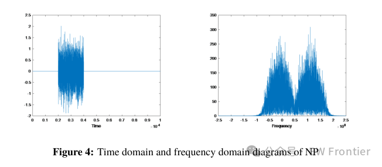
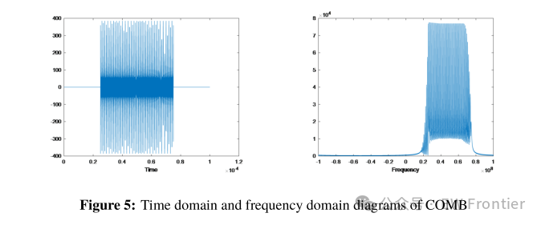
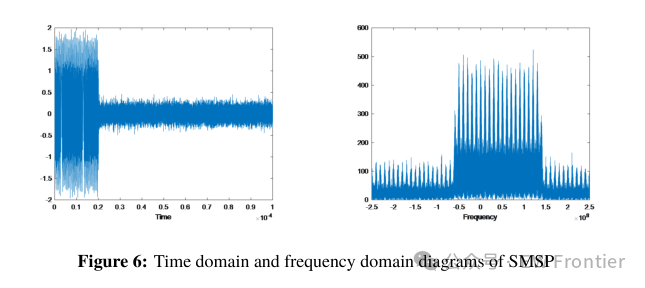
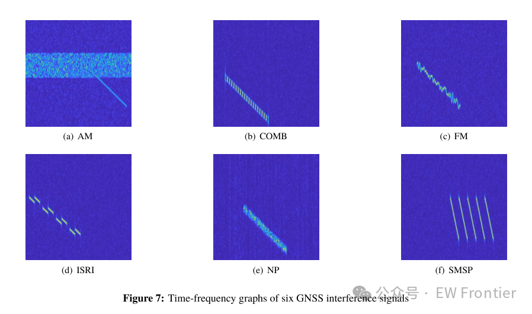
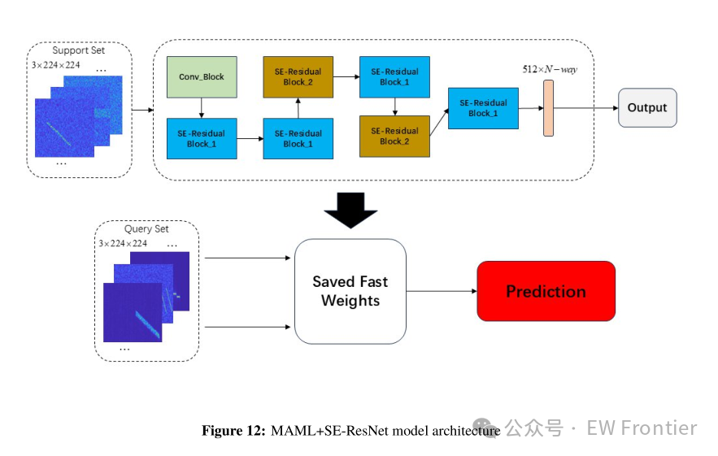
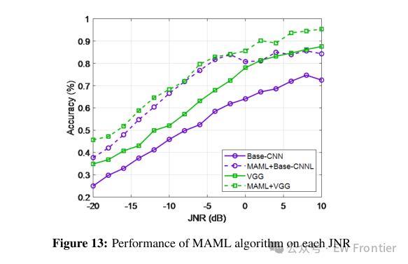
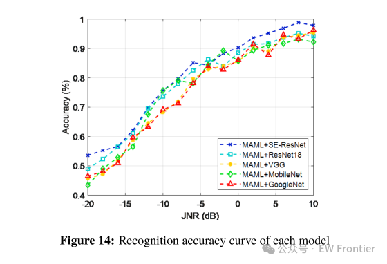
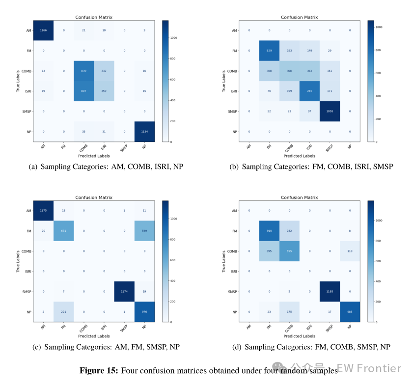

<!-- PAYMENT_BLOCK -->

## Get this dataset

- Payment link (Stripe): [Buy now](https://buy.stripe.com/3cs8yP7sY87d0vu9AB)
- Payment QR code: 

<!-- /PAYMENT_BLOCK -->
